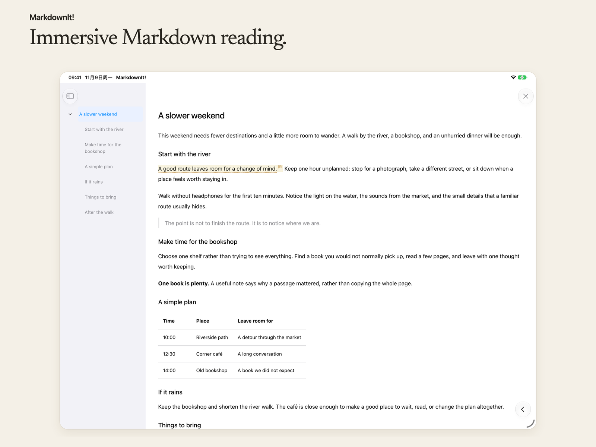
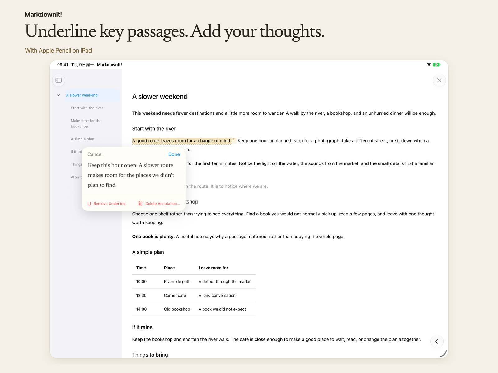
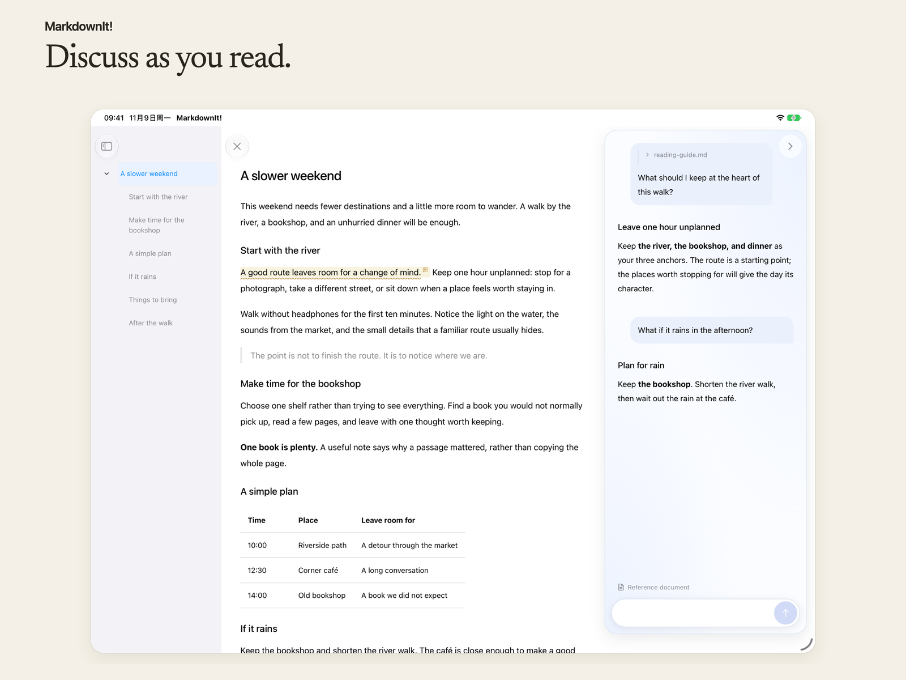
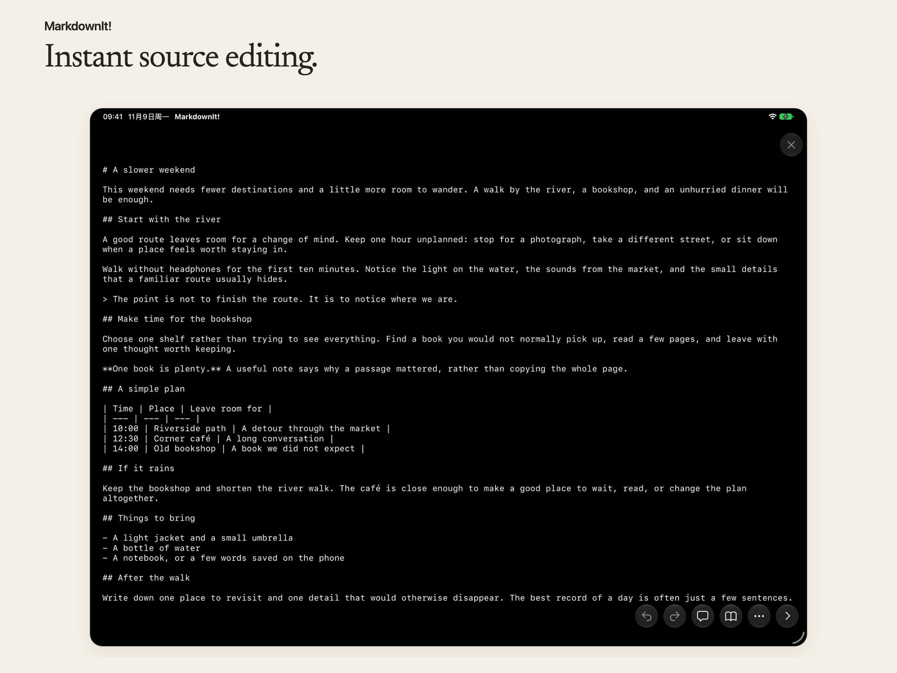

# MarkdownIt!

[简体中文](README.md) · English

*just markdown, pure reading.*

A Markdown reader for iPhone, iPad, and Android phones.

[Download on the App Store](https://apps.apple.com/us/app/markdownit/id6828690319) · [Download the Android APK](https://github.com/lichenxicatapple-blip/MarkdownIt/releases/latest)

  
  

  
  

