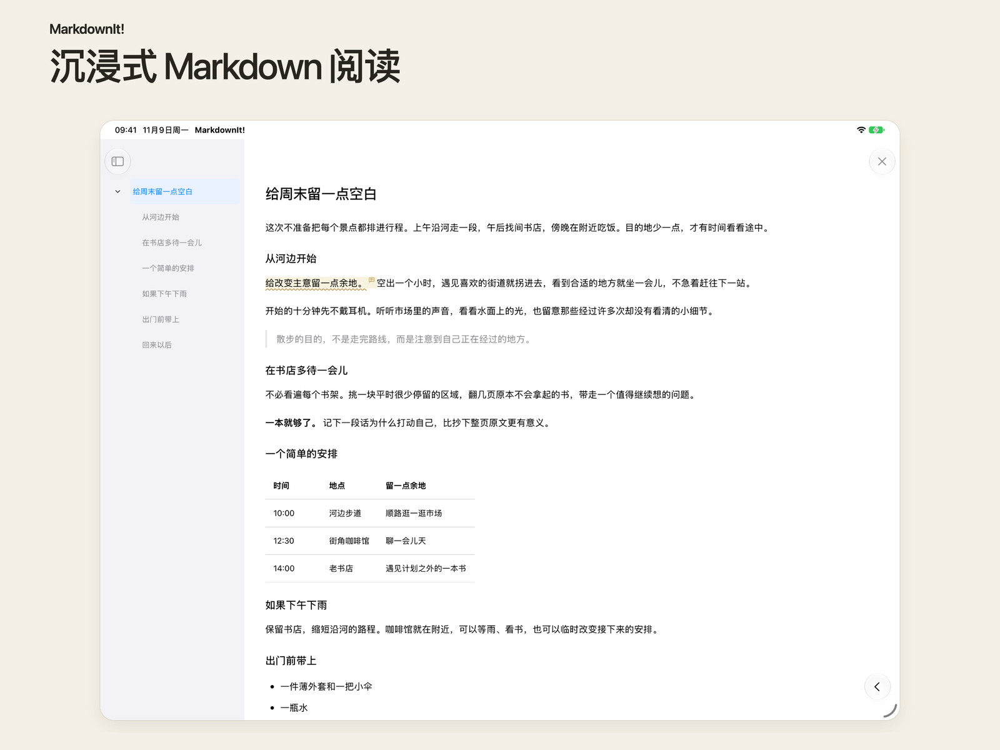
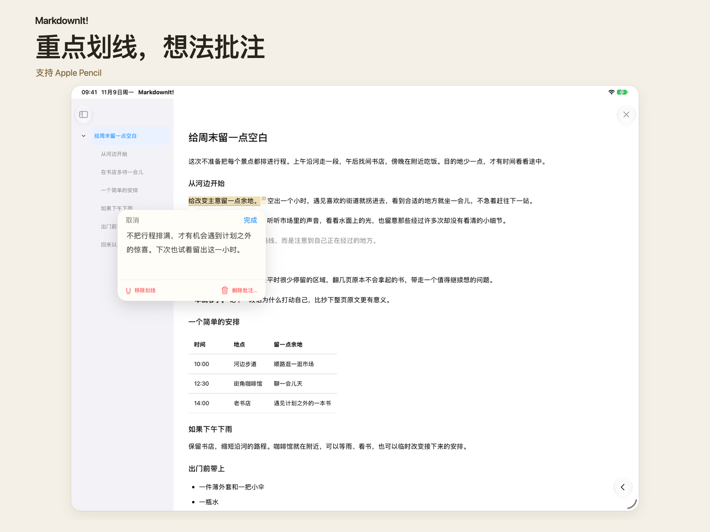
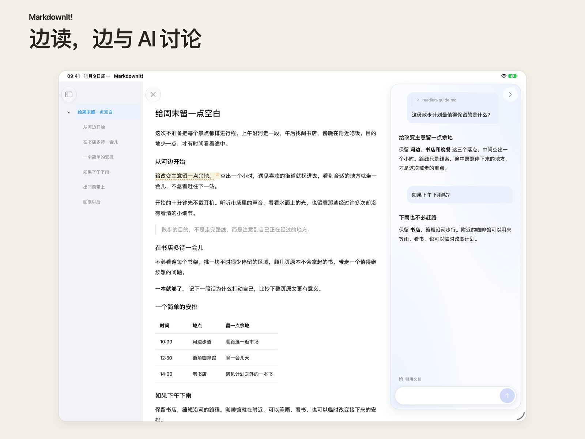
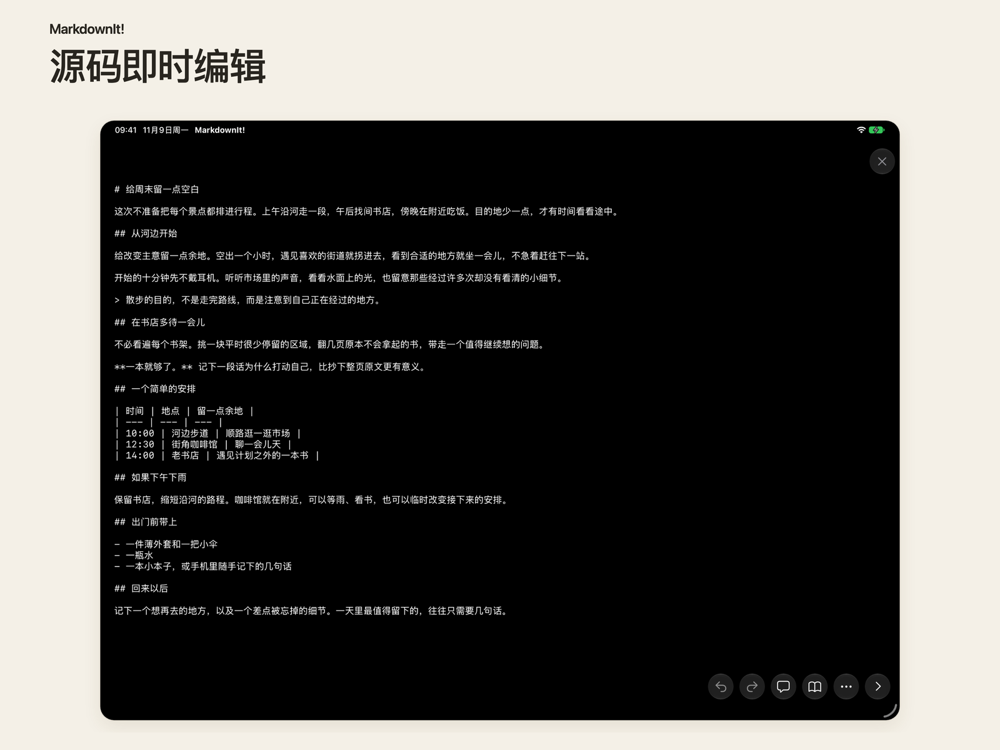

# MarkdownIt!

简体中文 · [English](README.en.md)

*just markdown, pure reading.*

适用于 iPhone、iPad 和 Android 手机的 Markdown 文档阅读器。

[下载 Android APK](https://github.com/lichenxicatapple-blip/MarkdownIt/releases)

  
  

  
  

