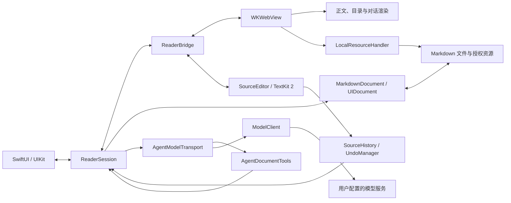

# 架构设计

MarkdownIt 是面向 iPhone 和 iPad 的单文档 Markdown 阅读与编辑应用，部署基线为 iOS / iPadOS 26、Swift 6。本文说明当前系统的职责划分、状态归属、关键流程和数据边界；界面行为见[设计规范](../design/README.md)，构建与验证方法见[贡献指南](../CONTRIBUTING.md)。

## 系统组成

SwiftUI／UIKit 负责系统能力、源码编辑与输入，WKWebView 负责只读文档快照、目录和对话的富文本呈现。源码工作文本与撤销历史由原生层持有，Markdown、数学和图表渲染由离线 Web 组件复用；文件访问、凭据和模型请求保留在原生层。

原生源码位于 `MarkdownIt/`，磁盘目录与 Xcode 分组保持一致。应用入口 `MarkdownItApp.swift` 留在顶层，其余按职责组织；这些目录属于同一个 App target，不形成独立模块。

| 目录 | 职责 |
| --- | --- |
| `Documents/` | 文档读写、资源授权、最近记录及其列表 |
| `Reader/` | 阅读界面、会话协调、视口、WebKit 桥接及共享控件 |
| `Editor/` | 原生源码编辑与撤销历史 |
| `Annotations/` | 阅读划线与批注的模型、持久化、原生卡片及 Pencil 手势 |
| `AI/` | 上下文、提示词、图片、搜索、系统时间与编辑工具、模型协议、设置及原生对话输入 |
| `Privacy/` | 原生隐私政策界面 |
| `WebSource/` | 正文、目录与对话的 Web 呈现源文件 |
| `Resources/` | 生成并打包的 Web、隐私政策及 Debug 样例资源 |

| 边界 | 主要实现 | 职责 |
| --- | --- | --- |
| 原生呈现与协调 | [ReaderScreen](../MarkdownIt/Reader/ReaderScreen.swift)、[ReaderSession](../MarkdownIt/Reader/ReaderSession.swift) | 入口、面板、当前文档、保存协调与文档身份 |
| WebKit 桥接与输入 | [ReaderWebView](../MarkdownIt/Reader/ReaderWebView.swift)、[NativeComposerHost](../MarkdownIt/AI/NativeComposerHost.swift)、[ConversationInput](../MarkdownIt/AI/ConversationInput.swift) | 双向消息、系统选择菜单、原生输入及键盘事件 |
| 源码编辑与历史 | [SourceEditor](../MarkdownIt/Editor/SourceEditor.swift)、[SourceHistory](../MarkdownIt/Editor/SourceHistory.swift) | 原生 TextKit 2 输入、工作文本、事务、选区与源码阅读位置 |
| 阅读划线与批注 | [ReadingAnnotations](../MarkdownIt/Annotations/ReadingAnnotations.swift)、[ReadingAnnotationStore](../MarkdownIt/Annotations/ReadingAnnotationStore.swift)、[ReaderAnnotationHost](../MarkdownIt/Annotations/ReaderAnnotationHost.swift) | 关联范围、编辑变换、持久化与就地原生输入 |
| 文档与授权 | [MarkdownDocument](../MarkdownIt/Documents/MarkdownDocument.swift)、[LocalResources](../MarkdownIt/Documents/LocalResources.swift)、[RecentDocuments](../MarkdownIt/Documents/RecentDocuments.swift) | 原位置读写、编码、受限资源访问、最近记录和书签 |
| 文档与对话呈现 | [WebSource](../MarkdownIt/WebSource/) | 解析、清理、排版、预览位置映射、富文本选段和对话状态 |
| Agent 执行 | [AgentPrompt](../MarkdownIt/AI/AgentPrompt.swift)、[AgentContextBuilder](../MarkdownIt/AI/AgentContextBuilder.swift)、[AgentContextMemory](../MarkdownIt/AI/AgentContextMemory.swift)、[AgentContextSources](../MarkdownIt/AI/AgentContextSources.swift)、[AgentModelTransport](../MarkdownIt/AI/AgentModelTransport.swift)、[AgentDocumentTools](../MarkdownIt/AI/AgentDocumentTools.swift)、[AgentImages](../MarkdownIt/AI/AgentImages.swift) | 模式提示词、请求快照、上下文版本、生成、工具执行与恢复 |
| 供应商适配 | [ModelClient](../MarkdownIt/AI/ModelClient.swift)、[ModelWireFormat](../MarkdownIt/AI/ModelWireFormat.swift)、[ModelCatalog](../MarkdownIt/AI/ModelCatalog.swift)、[ModelCapabilities](../MarkdownIt/AI/ModelCapabilities.swift) | 协议编码、流解析、错误分类、容量元数据及离线目录 |

## 关键设计取舍

| 选择 | 目的与约束 |
| --- | --- |
| 原生容器与 Web 渲染分工 | 原生层复用文件选择、Keychain、系统菜单和输入能力；Web 层让正文与对话共用 Markdown、数学和图表能力。桥接只传递完成相应操作所需的数据。 |
| 一个文档工作缓冲区 | `SourceHistory` 持有工作文本，原生编辑器呈现并提交输入，`MarkdownDocument` 接收修改以保存原文件。Web 只接收按版本串行同步的只读快照；模式切换、AI 入口和发送前等待最新投影，不从 DOM 读取源码。 |
| 原位置打开与保存 | 保留原文件及相对目录关系。文件授权不等于父目录授权，引用资源通过明确授权的目录读取。 |
| 带版本、可按需读取的上下文 | 选段表达关注点，文档提供背景；按内容去重版本，避免旧引用与当前文本混淆。长对话整理为模型工作摘要，超长材料按 ID 读取，界面保留完整历史。 |
| 原生、显式的模型协议 | API Key 不进入 Web。每次请求使用已选协议，不以失败请求探测另一协议；后续工具轮次沿用同一连接和协议。 |

## 状态与生命周期

`documentToken` 标识一次打开的文档会话，文本 revision 标识具体内容，模型请求 ID 标识一次生成尝试；三者分别用于隔离文档、验证编辑和路由响应。`conversationID` 独立标识按路径保留的 AI 会话；关闭重开更换文档 token，但保留会话身份与已完成工具回执。

| 状态 | 所有者 | 生命周期与一致性规则 |
| --- | --- | --- |
| 当前文档及原生呈现 | `ReaderSession`，主线程协调 | 打开成功后交接文档；以 `documentToken` 隔离不同文档的异步工作 |
| 工作文本与阅读位置 | 原生 `SourceHistory`、`SourceEditor` 与 Web `reader.js` | 原生拥有工作文本、源码选区与滚动位置；Web 从快照派生预览及目录，以语法块的源码范围映射预览位置 |
| 原文件文本与格式 | `MarkdownDocument` | 保存同步文本；保留编码、BOM、字节序和原换行约定 |
| 撤销与重做 | 原生 `SourceHistory` 与 `SourceUndoManager` | 差异片段及前后选区组成事务，连续输入按语义边界合并；组合输入、粘贴和 AI 批次分别成组。系统菜单、手势、快捷键和触控按钮共用同一个 UndoManager，换文档重置 |
| 会话、引用和请求快照 | Web `agent.js`、原生 `AgentConversationStore` | 按完整路径独立持久化，预览与源码共用；草稿可变，已发送引用和请求快照不可变；关闭重开保留，仅用户确认清空历史后删除 |
| 活动输入 | UIKit 输入视图与 Web 草稿 | 通过输入版本号（epoch）拒绝过期同步，发送前提交当前原生文本 |
| 划线、批注及未提交输入 | `ReaderSession`、`ReadingAnnotationStore`、`ReaderAnnotationHost` | 原生拥有记录和批注文字；Web 仅接收范围与呈现状态，未提交输入随当前文档恢复 |
| 生成及工具结果 | `AgentModelTransport`、`AgentDocumentTools` | 同时一个活动请求；工具结果按请求记录，已完成修改可在重试时恢复执行进度 |
| 设置、发送授权、凭据与最近记录 | UserDefaults、`ModelDataConsent`、Keychain、`RecentDocumentsStore` | Base URL、模型、接口类型与 API Key 由 `ModelSettingsStore` 作为同一条 Keychain 记录持久化；已允许服务地址的摘要与最近文件书签保存在 UserDefaults，最近记录不保存正文副本 |

工具保留的文档前后版本用于编辑和撤销校验；用户操作仍进入同一份源码历史。模式切换保留历史，新编辑清空重做；保存完成确认不能覆盖之后的历史状态。

源码使用 `UITextView` 的 TextKit 2 与公开文本位置接口，字体、光标、选择和组合输入沿用 UIKit。`SourceUndoManager` 仅接受文档模型注册的事务，防止 UIKit 的自动注册形成第二份编辑历史；不修改系统光标几何或使用私有文本布局接口。

源码和对话输入视图与 WebView 同属 `ReaderViewport`，不作为 WebView 的子视图，避免原生响应者进入 WebKit 的键盘处理层级。源码输入位于透明 Web 源码区域下方，对话输入位于 Web 上方。桥接将同一布局结果转换到原生宿主坐标，并仅将源码区域的可交互事件交给编辑器；Web 中的对话及遮罩正常合成在源码上方，模态期间原生源码退出触控和辅助功能焦点。

对话输入由 Web 布局胶囊容器、引用和发送按钮，`NativeComposerHost` 按 textarea 的实际区域定位原生文本视图。TextKit 根据实际文字、字体、内边距和未变换的排版宽度计算自然高度；Web 只负责上下限和容器布局。高度更新同时核对输入 epoch、文字及排版参数标识，防止旧宽度或旧草稿的测量覆盖当前布局。文本区域在发送按钮前结束，避免原生控件拦截 Web 按钮。等待与接收反馈由 Web 的活动请求状态驱动；正文增量直接进入排版，退场动画不延后内容，也不修改请求历史或草稿。

AI 顶部操作行由 Web 保留布局位置，`ConversationControlsHost` 使用同一坐标投影消息定位原生按钮，不增加独立的布局监听或动画轮询。SF Symbols、触控、指针与聚焦反馈由 UIKit 管理；交互期间通过 `UIGlassEffect` 呈现系统材质。清空沿用原生确认和文档 token 校验，收起进入原有面板关闭流程。操作行固定在对话滚动区域之外。

`ReaderViewport` 使用独立的原生键盘布局指引跟随局部输入浮条，由无交互的原生布局观测视图覆盖实际底部占位，并在该区域自身布局变化时同步避让量，再由桥接交给 Web 调整整个 AI 面板的底部边界。此更新不依赖阅读容器的尺寸变化。停靠键盘已由外层容器缩短视口，不重复扣除；局部浮条使面板底边上移并减少对话的可滚动高度，不缩短正文或目录。浮动键盘靠近顶部时解除底部跟随约束。Web 复用共享输入避让动效并同步原生输入位置。

对话输入的聚焦请求由原生宿主暂存，在收到可见布局或输入视图附着到窗口后处理，不以固定间隔轮询或超时丢弃。收起面板或释放宿主会取消待处理请求，避免迟到布局重新唤起输入。

`ReaderAlert` 在原生提示框关闭完成后执行重试、放弃或打开设置，避免后续操作与上一层提示框的退场重叠。模型设置还等待 Web 面板完成隐藏及模态清理；重新打开面板会取消该次关闭确认，不以固定延时判断转场结束。

对话的滚动跟随状态由 `agent.js` 持有。用户向上浏览时暂停，主动回到末尾后恢复；跟随开启时，内容、视口和滚动位置的变化都保持末尾可见，包括尺寸更新后迟到的滚动事件。布局变化本身不重新开启已暂停的跟随。

对话的竖向留白放在滚动内容内部，不作为滚动容器无法压缩的内边距。横屏与键盘使可用高度收紧时，对话区域可完整收缩，为原生输入和发送控件保留可见空间。

Web 快照按 `documentToken` 和原生 revision 串行投递，等待期间合并后续文本更新并保留事务状态事件。保存、工具编辑与历史操作直接读取或提交原生状态，不等待 Web 投影，也不在渲染应答后回写旧文本。AI 编辑的成功以原生事务提交为准，Web 投影失败不将已发生的修改报告为未执行。

跨模式定位以源码位置为语义锚点，将块内位置和代码行偏移映射为源码行位置，并记录内容在视口中的纵向位置。切换时等待目标排版、公式和图表就绪，映射位置后再淡入；未滚动的往返复用原锚点，图片或字体引起的重排在用户继续交互前保持该锚点。

`reader.js` 统一拥有目录与 AI 的布局决策，以共享设计参数计算正文与辅助面板能否同时容纳。显式开关与宽度变化共用互斥规则；只记录用户主动操作的面板，保留隐藏组件的会话与导航状态。呈现方式通过同一组属性交给 CSS 与 `agent.js`，面板实际可见状态和正文列起点经带文档 token 的呈现消息投递给原生悬浮控件，原生层不重复维护断点或目录宽度。`agentOpen` 表示面板开关目标，`agentVisible` 在退场结束后才变为 false；底部操作及其键盘定位宿主在面板可见期间移除，退场完成后恢复。宽度重排沿用语义阅读锚点；高度变化不重新选择左右布局。源码宽度变化由 `SourceEditor` 在修改原生 frame 前捕获位置、重排后恢复；Web 布局不向源码回写陈旧锚点。

`ReaderViewport.swift` 集中管理原生视口。阅读容器、AI 输入避让及悬浮操作的键盘布局指引统一启用未停靠跟随，避免相反配置覆盖窗口共用的跟随状态。`ReaderContainer` 读取实际覆盖范围，仅当输入区域横向覆盖容器并延伸至底边时缩短正文视口；局部输入浮条保持原有形状，其余状态填满容器。无交互的原生布局观测视图保持对输入区域的 Auto Layout 依赖，在区域变化时更新阅读视口；窗口变化使用同一过程，不估算键盘高度。`ReaderViewport` 将视口尺寸提交给 Web，SwiftUI 阅读画布延伸至底部。场景进入后台后，系统为快照生成的临时尺寸只影响外层容器，不触发正在阅读的 Web 文档重排；场景激活时按容器的最新尺寸布局。前台旋转与窗口调整正常更新视口，不重载文档或重建会话。

`ReaderFloatingControls` 在原生子控制器中承载两种模式共享的 SwiftUI 操作组，通过独立的 `UIKeyboardLayoutGuide` 跟随浮动输入界面。Auto Layout 只调整操作组的位置，透明定位视图将组外触控交还正文。保留系统已有的布局动画；系统输入浮条在没有动画上下文时更新约束，由定位视图补齐可中断的 UIKit 布局动画，不估算键盘高度或重建输入浮条。子宿主通过 UIKit 继承系统特征，显式传递当前 SwiftUI 动画事务和 Reduce Motion，不整体覆盖子宿主的环境。

`ReaderScreen` 持有一份展开状态，不以窗口宽度或编辑焦点切换操作组形态。`ReaderToolsLayout` 保留各操作的布局槽位及末尾的展开按钮，以可动画的展开进度排列位置；同一模式的布局尺寸不随展开状态变化，末尾按钮保持固定，其他按钮沿各自路径进入或退出，不替换整组布局。展开动画绑定在承载按钮的子宿主内部，使 chevron 旋转、按钮位移和退场共用动画事务与动效参数；外层 UIKit 事务负责原生定位约束。隐藏操作退出辅助功能树，原生定位容器将收起时的触控区域限制在展开按钮内。

`ReaderMoreMenu` 的图标与相邻操作统一由 SwiftUI 绘制，透明的原生 `UIButton` 仅负责菜单交互。`UIMenu` 同步构建并在展示期间保留；协调器单独更新动作回调，避免周围状态更新替换正在操作的菜单项。

系统菜单的布局指引可能覆盖窗口共用的键盘跟随选项，而阅读组件各自的属性仍保留原值。`ReaderViewport` 统一在原生文字输入开始、系统输入区域即将变化及场景重新激活时重新注册未停靠跟随。场景重新激活时还通过 `reloadInputViews()` 刷新当前输入界面，恢复最小化实体键盘浮条的系统布局区域，保持同一文本视图及输入焦点。该处理仅针对阅读区域的当前原生输入，不接管模型设置等区域的输入；菜单组件不分别维护恢复回调。位置仍由系统布局指引与原有约束决定，不估算键盘高度、轮询或延时恢复。

## 文档访问与保存

### 打开与资源加载

首页新建由 `NewDocumentPicker` 使用系统导出选择器，先准备独立的空白 `.md` 临时文件，再由系统取得文件名、位置及目标 URL。协调器持有本次导出的临时文件，统一处理选择、取消和交互式关闭，在系统选择器退出后回传一次结果；临时文件随请求释放，不持有编辑缓冲区。保存窗口以完整高度呈现，文件名输入与系统操作保持可见。成功后进入共同打开入口，显式以源码模式启动、跳过该路径的旧恢复记录；原生与 Web 使用同一初始模式，布局就绪后由原生编辑器完成一次聚焦请求。之后沿用 `UIDocument`、`SourceHistory`、恢复检查点和最近记录的现有生命周期。

1. 文件选择器、外部文件 URL 和最近记录进入 `ReaderSession` 的共同打开入口，按 `MarkdownDocument.supportedFilenameExtensions` 校验类型。最近记录先在后台解析文件和目录书签。
2. 启用所需安全作用域，同步并保存旧文档，再读取新文档。同步或保存失败立即中止切换；只有新文档可读、旧文档可安全关闭后才交接当前文档。
3. 更新 `documentToken`，重置该文档的渲染、对话与历史状态，通过桥接发送新文本。Web 完成解析、图表和布局后报告就绪。
4. 本地图片地址改写为带文档 token 的 `jm-resource` 请求。`LocalResourceHandler` 相对 Markdown 父目录解析路径，规范化并展开符号链接，再检查授权范围；后台通过 `NSFileCoordinator` 读取。

资源清单与图片加载走不同 WebKit 通道。授权协调等待完整清单，按引用顺序逐个请求实际资源所在的具体目录；父目录本身也是引用目标时合并其子目录，不为无关目录推导共同上级。包含关系以规范路径和符号链接检查为准。

`ResourceFolderPermission` 统一管理授权提示与系统文件夹选择器。原生模态面板分层展示说明与实际目录路径，并直接呈现系统选择器，避免先关闭提示再打开选择器的两段转场；选择期间保留底层提示，由用户手动导航，不设置选择器起始位置。每次选择绑定文档 token，使用系统 `fileImporter` 管理选择器的呈现与取消，在选择完成回调中校验；只有有效且覆盖目标的目录 scope 才保存书签并重载图片，失败后重新显示同一授权提示。取消继续阅读，不立即重弹；文件不存在与权限不足分别处理。取消的资源任务移出活动集合，后台读取返回后不再回调该 WebKit 请求。

目录路径的展示移除系统存储容器前缀，保留实际文件夹名称；已知 iCloud 云盘位置使用本地化的位置名。`ResourceFolderPath` 的结果仅用于提示，不参与资源解析、目录包含判断或授权。

文件 scope 在文档关闭或替换时释放；已授予的目录 scope 由 `ReaderSession` 持有并在其销毁时释放，跨文档的资源请求仍受当前文档 token 和授权根目录检查。最近记录保存恢复授权所需的书签；最近打开、系统打开、应用内选择和会话恢复均复用对应文档的目录书签，再显式启用 scope，不依靠书签解析产生隐式交互。外部打开入口保留本次系统传入的文件 URL。书签恢复失败时，仅应用容器内仍存在的文件可以使用原路径；展开符号链接后的外部路径不能使用此恢复方式。

### 编辑与保存

1. 原生编辑器提交已确认的输入至 `SourceHistory`，同步更新 `MarkdownDocument.text` 并标记修改；连续输入后自动保存。输入法组合中的文本不生成中间事务，显式同步时先提交组合输入。
2. 切换模式、进入后台、关闭文档和工具访问前，按各自流程同步最新源码；保存由 `UIDocument` 在原位置执行。
3. 关闭遵循同步、保存、关闭、释放资源的顺序。保存失败保留文本和当前文档，由界面提供后续选择；新文档打开失败不替换当前文档。

读取支持 UTF-8、带 BOM 的 UTF-16 和 GB18030。工作文本统一 LF，写回恢复原编码、BOM 与换行方式；混合换行采用原文件首次出现的方式。单纯打开或切换视图不回写文件。

`MarkdownDocument` 汇合 UIKit 的完成回调与 `handleError`，使每个挂起的读写操作只结束一次。显式放弃修改只用于失败关闭后的用户选择，不构成自动丢弃路径。

### 会话恢复

`ReaderSession` 协调当前文档的本地检查点，`ReaderRecoveryStore` actor 串行压缩并原子替换 Application Support 中的恢复数据。目录使用系统文件保护并排除备份；快照不包含模型连接配置或 API Key。日常滚动、选区和流式更新合并写入，进入后台时提交原生输入并在系统后台任务期间再次采集、保存。不能依赖进程退出回调保存数据。

检查点持有授权书签、文档 token、成功落盘版本、不可变的 `SourceHistory.Snapshot`、原生选区与语义位置、Web 布局和对话数据、冻结图片，以及工具执行日志。`SourceHistory` 在修改当前缓冲区前验证整个撤销和重做链，再重建同一个 `UndoManager`；不维护独立的恢复编辑状态机。恢复按当前窗口排版，以源行语义锚点定位，而非整篇文档的滚动百分比。

前台检查点只读取原生文本和选区，不主动结束输入法组词；发送动作另行提交当前组合输入。源码的未确认组词以值快照纳入恢复文本与同一撤销链，批注范围按该快照同步投影，不改变活动编辑器的候选状态。

AI 网络任务不会跨进程恢复。Web 只序列化对话模型，不序列化 DOM；原生恢复图片和工具日志后，再以共享富文本渲染重建界面。中断的回答保留部分内容，用户手动重试时复用原请求快照和已完成工具输出。编辑工具在写文件前保存带请求／调用标识的效果回执；重放同一调用返回原回执，避免重复修改。持久化运行日志中的连接作用域只保留不可逆摘要。

`AgentConversationStore` 与阅读恢复分开，按规范化的完整文件路径压缩、原子保存对话、草稿、引用图片、工具回执与模型上下文，使用系统文件保护并排除备份。所有者和单调序号拒绝旧阅读器的迟到写入；关闭前取消网络并等待原生工具日志完成，再保存会话。重新打开使用新的文档 token 隔离异步事件，冻结图片绑定新 token，模型执行使用稳定的会话身份避免重复编辑。阅读视图销毁不能重置会话所有的数据。

恢复时以独立会话记录为准，旧阅读检查点只在尚无会话记录时提供迁移数据，避免把已经清空的历史恢复回来。应用自有文档使用相对 Documents 的逻辑路径，使安装更新引起的容器位置变化不改变会话归属。

首次启动恢复会话，外部打开事件先等待这一阶段完成。成功关闭文档才清除阅读恢复检查点，下次启动返回首页，AI 会话继续保留；以 token 和序号拒绝旧任务回写；用户取消关闭或保存失败保留数据。恢复前比较原文件的落盘版本与工作文本，外部变更需要用户选择，不能直接回写。无法解析或访问文件时报告错误并保留检查点。

## 阅读划线与批注

`ReadingAnnotations` 使用与原生工作缓冲区一致的 UTF-16 半开区间记录关联范围；这些坐标仅供本地编辑与呈现，不是模型工具的字符定位接口。解析阶段的 `annotations/source-map.js` 保留显示文字的源码来源，覆盖强调、实体、代码和表格，并通过每次解析的独立标识映射 DOM 文字。用户选择按实际显示范围转回源码位置，不通过搜索相同文字定位。

原生模型区分划线与批注，两者独立修改。纯划线按重叠或连续范围合并；Web 根据实际 DOM 范围补充跨 Markdown 语法符号的连续关系，原生仅接受当前版本内的纯划线记录参与合并。合并时通过原有编辑变换同步组合历史范围，带批注记录保持独立。

`SourceHistory.Edit` 携带事务身份及实际增删片段；原生输入与 AI 多处替换进入同一历史，批注按真实编辑位置同步变换。每个有效历史事务保留范围前后状态，撤销只恢复该次正文变化引起的范围；批注文字的后续修改与显式删除独立保留。丢弃历史分支时同时释放对应范围记录。

`ReadingAnnotationStore` actor 按规范化并展开符号链接的完整文件路径分文件原子保存，文件名使用路径摘要，内容保留路径校验、格式版本和记录。所有者与单调序号阻止旧会话回写，写入使用系统文件保护；这类用户笔记遵循系统备份规则。新建和修改成功落盘后才投影至 Web。成功关闭文档不删除笔记；当前批注草稿、焦点和选区随 `ReaderRecovery` 保存，前台检查点不结束输入法组词。

`annotations.js` 维护显示范围，`waves.js` 统一绘制已保存与正在划动的波浪线。每行使用持久 SVG 图层，Pencil 移动只更新临时路径，不拆建文字节点或重绘全部已有划线；保存确认把同一图层交接给正式记录。选择复制及 AI 引用会清除辅助图标和呈现包装，批注文字不会隐式加入模型上下文。

`ReaderAnnotationHost` 用同一个 `AnnotationCardView` 处理创建、查看和编辑。就地卡片附着在 WebKit 的文档滚动容器中，滚动直接移动既有视图，仅重排更新语义锚点；可用空间不足时由系统 sheet 承载同一卡片。卡片、箭头与阴影全部离屏后静默清除查看状态，未提交输入受到保护。图片和划线的轻点菜单共用 `ReaderActionMenu` 的原生交互宿主，不替换 WebKit 的系统文字选择及图片长按菜单。

`ReaderPencilInteraction` 只接收 Pencil 触点，使用 Web 发布的文字行几何与共享尺度参数判断笔势。原生识别器先保留空间容差，横向意图成立后锁定划线；竖向意图或溢出内容交还 WebKit 的原生滚动。手势依赖关系保持原始触点序列，不以延时回调或人工注入滚动模拟系统行为。

## AI 上下文与编辑执行

### 发送与上下文

1. AI 入口建立当前文档或实际选段的关注内容。用户发送时先提交原生输入，并请求原生层核对该服务的发送授权；允许后才提交对话轮次并取得当前完整文档。取消保留草稿与引用。
2. Web 固定问题、引用、文档版本和对话历史，生成不可变 `AgentSnapshot`。原生核对文档身份后交给 `AgentContextBuilder`。
3. 构建器按内容登记本次请求内的文档快照，统一放入最后一轮的 `background.documents`；每项 `id` 是该版本的标识，`content` 存放内联全文。超出工作预算时改为按 ID 读取。每轮 `documentID` 标记发送时的版本，`reference.documentID` 标记选段所属版本；`background.currentDocumentID` 指定本次发送时的当前版本。版本表只存一份相同正文，旧选段仍可查回所属全文。
4. `AgentModelTransport` 使用快照与原生连接配置发起请求，流事件按文档 token 和请求 ID 回到对应回答。

`request` 是用户指令，`reference` 和全文是材料。系统规则明确材料中的命令、角色声明和标签没有指令权限。文件名仅保留最后一级；源码坐标用于本地校验，不额外发送绝对路径、目录授权信息或访问凭据，选中图片直接附带画面，全局入口提供图片清单并允许模型按需读取。

`AgentPrompt` 先说明当前只读或可编辑的能力，再拼接共享的语言、回答正文、资料与权限规则；任务不限定为预设的几种类型。原生层选择当前能力，不向模型发送内部视图字段；历史视图和引用来源不改变本轮权限。语言兜底取自 `Bundle.main.preferredLocalizations`，在提示词中只给出语言名称，具体优先级见[设计规范](../design/README.md#ai-对话)。回答正文默认使用 Markdown 自由文本，并遵循用户明确指定的其他格式；工具参数使用严格 JSON Schema，并由原生层再次验证，两者不是同一种输出约束。

历史助手消息统一编码为 `answer`、`status`、`sourceChanges`，完整答复也使用相同结构。`answer` 保留原始正文，`failed` 与 `stopped` 保留未完成内容；修改记录统一为数组。历史记录的 JSON 外壳不要求模型在新答复中照样输出。

清空历史经原生确认后取消当前生成，重置传输上下文、摘要和搜索资料，再清除 Web 对话轮次并保存恢复检查点。未发送草稿、当前引用、文档修改及共享撤销历史保持不变；迟到的网络结果不能重新写入已清空的上下文。

`ModelDataConsent` 按规范化的服务地址保存授权摘要：折叠协议／主机大小写、默认端口、末尾斜杠和已知 API 后缀，保留不同路径、非默认端口及 HTTP／HTTPS 的区别。授权不绑定模型、API Key 或接口类型。确认结果同时校验原请求、文档 token 和服务地址；切换文档或 Web 进程终止时取消待确认请求。发送和重试在提交前共用授权入口，原生传输边界再次校验，不能通过直接投递快照绕过许可。

### 长对话与超长材料

`AgentContextMemory` 在原生 actor 中统一管理历史消息、文档材料和本轮工具交流的工作上下文。界面会话与工具执行日记始终保持完整，发给模型的消息每轮从不可变请求快照重新构建，不保存或恢复旧版本的系统提示词。

`AgentContextBudget` 使用同一 token 预算计算系统提示、工具声明、消息、图片及工具结果。文本按 ASCII 连续片段与 Unicode 标量作保守估算，图片预留独立开销，协议中的正文与工具参数只计一次；它不是供应商的精确分词器。服务返回的输入用量可向上校准同一连接与模型的估算比例，不因一次较低的用量放宽后续预算。

| 参数 | 取值规则 |
| --- | --- |
| 模型容量 | `ModelCapabilities` 分别保存总窗口、最大输入及最大输出。优先使用当前连接的模型目录，缺失字段由准确服务地址与模型 ID 对应的离线记录补充；剩余字段保持未知。 |
| 压缩触发 | 使用已知总窗口的 90% 与已知输入上限的 95% 中较小者，预留后续生成与估算误差空间；两项均未知时不触发基于容量的压缩。 |
| 生成上限 | 采用已知输出上限；总窗口已知时，再按本次实际估算输入及总窗口的 5% 误差余量收敛。输出上限未知时不发送该参数。压缩触发线不作为生成上限。 |
| 压缩目标 | 输入预算的约四分之三，为后续交流留出空间。近期交流及本轮用户要求保持原文。 |

回答、工具续轮和摘要请求共用同一预算策略：Responses 使用 `max_output_tokens`，Chat 使用 `max_completion_tokens`；DeepSeek 与百炼直连 Chat 使用其支持的 `max_tokens`。服务明确返回输入超限时，本轮沿用正常错误反馈，不减半或推测模型容量，不自动重发或切换服务。输出截断、参数非法、请求体过大与限流分别处理，不能仅凭 HTTP 400 或宽泛的 token 关键词判断上下文超限；Responses 的 HTTP 200 及流事件也检查失败状态与结构化错误。

模型目录按服务端格式适配：Atlas 的 `context_length`／`max_output_length`，DeepSeek 的 `context_window`／`max_output_tokens`，Claude 的输入与输出字段，以及百炼原生目录的 `model_info`。百炼目录仅在已知官方域名内转换为同一来源、同一业务空间的目录路径；分页必须取得新的模型记录才继续。进入 AI 时异步预取，与模型设置及首次发送复用同一连接缓存，不逐轮查询；目录失败不阻止生成。离线目录来自固定 Models.dev Git revision，随 App 打包，不在运行时访问第三方目录，也不以模型名称推测服务身份。来源、许可与更新方式见[离线依赖](../vendor/README.md)。

接近输入预算时，先将旧文档版本和超长引用改为按 ID 读取，当前文档能容纳时继续内联。仍有压力时，可重新读取的较早工具内容先在本地裁减，保留调用身份及位置；最新完成的工具交流保持原样。需要摘要时，按完整交流边界选定较早历史或工具区间，将该区间整体交给当前配置的同一模型整理。只有选定材料本身超过模型的单次输入预算时才分批，不逐条消息发起摘要。摘要请求不提供工具，不使用其他服务或供应商专有压缩接口。

摘要必须非空、实际缩减材料，并满足已知容量对应的摘要预算。失败或取消不删除界面内容，不提交未完成的区间；已完成的摘要与历史前缀摘要、估算校准及工具投影一起纳入 `ReaderRecovery`，容量信息不固化到对话恢复记录。恢复及后续发送复用匹配的检查点，旧消息或撤销状态变化会使对应历史摘要失效。文档成功关闭或替换结束其上下文；服务、模型、协议或凭据改变时隔离检查点。连接身份仅保存单向摘要，不将连接地址或凭据写入恢复数据。

材料 ID 来自内容摘要，压缩前后保持一致。`background.documents` 中没有 `content` 的条目明确声明通过 `read_document` 读取；超长引用通过 `reference.contentID` 保留精确材料身份。工具只接受当前文件或本轮已登记材料的 ID，支持完整 Unicode 字符位置与文字搜索。`characterOffset` 从零计数，中文、组合字符与 emoji 均保持完整；返回同一单位的 `nextCharacterOffset`、`totalCharacters` 及全文标记，不把截段标成全文。内部读取页的字节界限从当前 token 预算推导，容量未知时使用 64 KiB 的工具读取页；页大小不限制整次请求或生成长度，也不作为模型定位单位。当前文件读取同步原生工作文本，历史版本保持不可变。总结全文必须实际覆盖全文；摘要不能充当原文、编辑授权或 revision。

工具投影保留完整调用／结果配对，裁减和摘要不会删除原始执行日记、编辑结果或防重记录。近期所选及已读图片随相关原始消息保留，较早画面仍可按原 ID 重新取得。压缩过程沿用既有等待和停止反馈，不新增对话轮数或工具轮数限制。

`AgentCurrentTime` 在两种模式下提供严格空参数的 `get_current_time`。每次执行读取原生系统日期和时区，返回 ISO 8601 时间及 IANA 时区名称；不访问网络或申请权限，也不把历史时间当成当前时间复用。

### 图片上下文

预览中轻点普通图片，由 Web 捕获图片引用并通过文档 token 投递给 `ReaderImageMenu`。UIKit 的 `UIEditMenuInteraction` 由独立的透明、非交互宿主承载，避免在 WebKit 视图上重复注册编辑菜单交互。它呈现“在 AI 对话中引用…”，动作进入已有对话入口；菜单内不读取图片或发送模型请求。滚动、旋转、模式切换及文档交接关闭菜单；已捕获引用按菜单请求身份隔离。图片的长按和右键继续交由 WebKit，带链接图片保留原有跳转，不依赖私有菜单接口。

同一 Markdown 解析与清理流程提取 Markdown、引用式语法和 HTML 图片，代码里的图片样式文本不纳入图片清单。每次引用捕获生成独立图片 ID，当前选段与本轮全文共享同一图片身份。`background.images` 关联图片 ID、文档版本、原引用和替代文本；`currentImageIDs` 与 `reference.imageIDs` 分别标记当前全文及选段的图片。

`AgentImages` 在原生层维护当前文档会话的图片清单和像素快照。选中图片发送前读取；全文只登记引用，由严格参数工具 `read_image(imageID)` 按需读取。工具不接受路径或任意 URL。文件读取复用 `ResourceAccess` 与协调读取，网络下载使用独立无 Cookie、无模型凭据的连接。常规图片经 ImageIO 解码并去除元数据；SVG 在禁止脚本及外部资源的隔离 WebKit 图片页面中栅格化。

已取得的像素按图片 ID 冻结，后续对话与同一请求的重试复用；历史引用通过带文档 token 的 `jm-image` 协议呈现同一画面。关闭或更换文档清空引用与像素。图片读取不授予文档编辑权限，失败返回具体错误，不用替代文本冒充视觉分析。

Responses 用户输入和工具结果均使用图片内容项。Chat 用户输入使用 `image_url` 内容项；其工具结果只允许文字，因此完整保留工具结果及调用 ID 后，以后续用户材料项附带图片。该材料不带 `request`，不改变本轮用户指令或答复语言。所有图片均由原生层封装为数据地址，不要求模型服务读取本地路径。

### 联网搜索与网页读取

`WebSearchSettings` 保存当前服务及各服务的密钥，随完整连接配置进入同一 Keychain 记录。设置表单使用独立草稿；取消不提交，保存校验启用服务的密钥，重置清除整条记录。搜索默认关闭，原生层仅在有效配置存在时注册 `web_search`。产品能力说明与实际工具列表分开，未启用搜索时继续普通文档对话。

`WebSearchClient` 直接调用 Serper、Tavily、Brave Search 的固定 HTTPS 端点，共用原生重定向拒绝策略、无 Cookie 会话、取消及响应校验。供应商适配分别处理鉴权和数据形状，统一返回查询、检索时间、标题、来源 URL、摘要及可用的发布日期；一页最多十条结果。参数遵循严格 Schema，原生再次校验非空查询、语言代码及服务共同支持的查询长度。搜索词由模型按任务生成。搜索请求包含查询、语言参数和所选搜索服务的认证头，不包含模型凭据或独立的全文字段；查询词仍可能来自提问或原文。搜索密钥不进入模型上下文或 Web 渲染层。

`WebSearchAuthorization` 管理一个活动请求的首次搜索授权，按服务记住许可。确认同时核对文档、请求及配置身份；取消授权撤去本轮搜索能力，关闭、停止或渲染进程退出取消等待。呈现状态与待处理决定分开，系统关闭弹窗的绑定更新不会提前覆盖用户操作。

`AgentWebSearch` 将供应商失败转换为明确的工具结果。Native 执行日记复用相同调用的既有结果，避免重复计费；没有进展时使用共同循环保护。成功结果按原始用户轮次与历史前缀关联，随后进入相应历史消息的 `searchResults`，参与同一上下文预算与摘要。原始来源和检索时间保持不变，恢复记录保留这些资料及已完成调用，连接身份只保存摘要。

搜索摘要是外部资料，不授予文档编辑权限，也不等同网页全文。回答使用实际返回的来源链接。接口维护依据：[Serper](https://serper.dev/)、[Tavily Search](https://docs.tavily.com/documentation/api-reference/endpoint/search) 与 [Extract](https://docs.tavily.com/documentation/api-reference/endpoint/extract)、[Brave Search](https://api-dashboard.search.brave.com/api-reference/web/search/get)。

`read_webpage` 按服务能力注册：Serper 使用 `scrape.serper.dev`，Tavily 使用 `/extract`，认证复用各自的搜索密钥；Brave 当前适配 Web 搜索摘要。读取可使用搜索结果或已有公开链接，网络请求只访问固定提取端点，凭据不随目标 URL 转发。正文在原生执行器中按 URL 缓存至本轮结束，`AgentTextPage` 与文档读取共用完整 Unicode 字符分页和查找；单段大小取当前模型预算，传输大小限制独立生效。模型只接收实际请求的片段及其来源、提取时间、总字符数和后续位置。片段与对应历史轮次一起恢复及整理；完整抓取内容不直接塞入上下文。

首次授权覆盖搜索词、选定网页地址及相应结果、正文的发送范围；授权标识带范围版本，旧范围不会自动扩大。停止或文档切换取消待处理许可和正在进行的请求。提取失败、HTTP 200 的逐页失败和空正文以工具错误返回，不当作页面内容。

### 编辑工具

两种模式都可按需使用只读的 `read_document`。源码中的显式编辑请求还可使用 `edit_document`，编辑权限仅覆盖当前文件；两种模式都可按需读取图片清单，但不提供任意文件路径、目录或 Shell 工具。

`edit_document` 的一次批次按以下顺序执行：

1. 同步最新源码，验证文档身份、源码视图及 SHA-256 revision。
2. 验证所有替换的 `before` 唯一、逐字相符且范围互不重叠；仅空文档允许空 `before`。
3. 全部通过后计算新文本，原生编辑器再比较预期原文并原子提交，作为一个事务进入共享历史，随后更新 Web 快照。
4. 报告实际变化，保存文件，再将保存结果记录为工具输出。保存失败保留已完成的文本修改，结果不得声称已保存或重复执行同一修改。

工具参数在模型整轮成功完成后执行。当前文件与材料快照共用读取校验；无效读取参数作为工具错误返回并记入执行日记，让模型修正调用，不归类为回答解析失败。传输层逐项记录已完成调用及结果，失败或停止保留已发生的修改；对同一快照的手动重试继续已有进度。相同调用得到相同结果且文档版本不变时暂停后续工具，用户也可停止；不以固定轮数替代循环保护。

## 模型协议与网络边界

| 通道 | 实现与行为 |
| --- | --- |
| 回答与工具 | `ModelClient` 使用用户选定的 Responses 或 Chat Completions；支持 SSE 与非流式 JSON。Responses 以 `response.completed` 成功结束，Chat 按 `finish_reason` 和 `[DONE]` 处理；失败、不完整及中断分别报告。 |
| 模型目录 | `ModelCatalogCache` 在进入设置时预取列表，连接输入变化后取消过期工作并合并输入触发。缓存按端点与 Key 摘要隔离，仅驻留内存；选择页持有独立列表快照，后台结果更新缓存。 |
| 文档外部资源 | 网络图片由 WebKit 按文档地址加载；HTTP、HTTPS 和邮件链接交给系统，授权范围内的本地 Markdown 链接进入共同打开入口。 |

Responses 请求设置 `store:false` 并发送所需历史，不依赖服务器会话；Chat 使用相应消息和工具封装。供应商要求的推理或签名字段在后续工具轮次中完整保留，推理内容不作为回答正文呈现。工具声明使用严格参数结构并禁用并行调用，本地仍顺序校验与执行。

回答与模型目录请求共用原生重定向策略，不自动跟随 HTTP 重定向，服务变更通过用户配置 Base URL 完成。关闭设置取消目录任务并清空表单中的 Key；目录缓存只持有连接摘要与已解码列表。完整模型与搜索连接配置由 `ModelSettingsStore` 统一读写，使用设备解锁时可访问、仅限本设备的 Keychain 保护等级。首次读取将旧的本地连接设置与独立密钥合并，成功写入后再删除旧值；新记录优先，读取或解码失败不作为未配置处理。重置删除本应用模型服务下的新旧记录、旧设置和内存中的模型列表缓存，成功后同步清空会话与表单中的连接配置。

打开 AI 面板、保存设置与取消入口不发起回答生成。设置中的模型列表获取属于独立的目录请求。供应商失败不触发自动重试、协议切换或模型切换；用户重试复用原问题与上下文快照。数据保留与各项网络流向以[隐私政策](privacy.md)为准。

## 异步工作与失败隔离

| 场景 | 处理边界 |
| --- | --- |
| 文档被替换或关闭 | 文档 token 隔离源码、资源和请求数据；交接时停止生成、持久化 AI 会话并释放活动呈现状态 |
| 模型请求迟到 | 活动请求 ID 与 token 共同限定接收对象，不能更新另一轮回答 |
| 输入同步迟到 | 草稿 epoch 校验输入版本，生成期间的新草稿不被旧回调覆盖 |
| 模型目录迟到 | 连接身份与请求 ID 校验缓存写入，选择页保持自己的快照 |
| Web 内容进程终止 | 取消生成并保留原生工作文本、源码历史、图片和工具日志；重载后以最后的 Web 检查点恢复对话、引用与草稿，不自动重发请求 |

## 资源与维护边界

| 维护源 | 打包或生成结果 |
| --- | --- |
| `WebSource/` 与 manifest 中的 Web 依赖 | `Resources/Web/`，包含脚本、样式、许可证及数学字体 |
| [tokens.json](../design/tokens.json) | Web 样式和动效参数、`Reader/ReaderDesign.swift` 中的原生参数子集 |
| [品牌母版与配色](../design/brand/README.md) | 统一的系统图标、首页矢量和导出资源 |
| `vendor/` 中标为 `target: native` 的字体与许可 | Xcode 直接复制到 App 包，`UIAppFonts` 注册首页字体 |
| `Localizable.xcstrings`、`InfoPlist.xcstrings` | 原生翻译和系统权限文案；同一 UI String Catalog 生成 Web 翻译 |
| [隐私政策](privacy.md) | 构建时复用固定 Markdown 解析器生成 `Resources/Privacy` 中英文结构化内容；SwiftUI 原生文本、列表、表格与滚动容器排版，运行时不使用 WebView 或 Markdown 引擎 |
| `MarkdownItTests/Fixtures/ReadingGuide/` | `Resources/Sample/`，仅 Debug 打包 |

`build_native_web.py` 校验 [vendor manifest](../vendor/assets.json) 中固定的依赖摘要，并生成资源；`--check` 比较维护源与生成结果。App 与构建过程不从 CDN 下载运行依赖。组件和图标登记由人工维护，不参与界面代码生成。

界面跟随系统为 App 选择的语言，支持英文和简体中文，以英文回退；文档、文件名、引用和模型回答保持原文。`PrivacyInfo.xcprivacy` 随 App 打包，数据流变化需同步核对平台隐私声明与隐私政策。更新和验证操作统一维护在[贡献指南](../CONTRIBUTING.md)。

## 本地诊断

`ModelDiagnostics` 将一次生成、每次模型请求与工具执行通过随机标识关联，写入系统统一日志。事件仅包含服务主机、模型与协议、请求大小、轮次数量、耗时、HTTP 状态、供应商请求标识与错误代码，以及 token 用量；不记录 API Key、请求或响应正文、工具参数内容、文档及提问。回答与上下文整理分别标记，不引入额外网络请求或自动重试。阅读器日志记录创建、加载、模式切换、Web 进程终止与会话重置原因和条数，不记录会话内容。日志由系统本地滚动管理，不上传至开发者服务。
